# `synthesis` — Public Demonstration of Synthesis

> **Notice:** This is a demonstration build of Synthesis. The production engine is proprietary and is not included.

`synthesis` runs a deterministic, tamper-locked linearizability gate against a three-node Raft key-value cluster in Docker Compose: it catches an unsafe read-lease stale read with a machine-verified witness (`FAIL`, exit `1`), certifies the quorum-bounded fix only when the full locked world budget completes (`PASS`, exit `0`), and refuses weakened workloads, budgets, or oracle sets before starting a single container (`ORACLE_DRIFT`, exit `4`).


---

## Run it

Prerequisites: Go `1.22+` and Docker Engine with Docker Compose v2. No external network calls or telemetry occur at runtime; the entire demonstration runs locally over loopback and internal Compose networks in under 10 minutes.

**Linux and macOS:**

```sh
./demo.sh
```

**Windows (PowerShell 5.1+ or `pwsh`):**

```powershell
.\demo.ps1
```

Both scripts build `./bin/synthesis`, `./testdata/kvfixture/bin/loadgen`, and `./testdata/kvfixture/bin/linearizable-kv`, run `docker compose up --build` for both fixture variants (`buggy` and `kvfixed`), verify `.synthesis/lock`, and execute all three acceptance scenarios end to end:

1. **Catch (`AT-1`):** `synthesis run --project ./testdata/kvfixture --profile buggy --seed 20261109` injects `net.partition(role:leader)@3000..7500`, catches the isolated old leader serving a stale value after a newer majority write has completed, writes `verdict.json` and `witness.svg`, runs `synthesis explain`, and exits `1` (`FAIL`).
2. **Prove (`AT-2`):** `synthesis run --project ./testdata/kvfixture --profile patched --seed 20261109` runs the fixed variant (`kvfixed`) across both locked worlds (`2/2`), verifies every built-in and external oracle, and exits `0` (`PASS`).
3. **Refuse tampering (`AT-3`):** Reducing `driver.profiles.linear.ops` from `60000` to `100` in a copy of the locked project causes `synthesis run` to halt before booting any container and exit `4` (`ORACLE_DRIFT`).

### Recorded terminal walkthrough

| Scene | Recording | Outcome |
|---|---|---|
| **1. Catch the planted stale read** |  | `FAIL` (exit `1`) + `witness.svg` |
| **2. Patch the defect and prove the fix** |  | `PASS` (exit `0`, `2/2` worlds) |
| **3. Try to weaken the workload** |  | `ORACLE_DRIFT` (exit `4`, refused pre-boot) |
| **4. Narrow `--worlds 1` below lock** |  | `INCONCLUSIVE` (exit `2`, `lock=bypassed`) |

### CLI commands

`synthesis` exposes three subcommands only:

```text
synthesis verify-lock [--project <dir>]
synthesis run         [--project <dir>] [--profile <name>] [--seed <u64>] [--worlds <n>] [--budget <dur>]
synthesis explain     <path/to/verdict.json>
```

---

## The four verdicts and their exit codes

Every execution produces an explicit verdict and deterministic process exit code so CI pipelines and autonomous coding agents cannot mistake an incomplete, crashed, or weakened run for a passing gate:

| Verdict | Exit code | Meaning |
|---|---|---|
| `PASS` | `0` | `.synthesis/lock` matched, every planned world in the locked budget completed, client load overlapped every scheduled fault window, and every configured built-in and external oracle returned `ok`. |
| `FAIL` | `1` | At least one built-in or external oracle witnessed a safety or liveness violation; `verdict.json` records the violation, witness operation IDs, and causal timeline, and `witness.svg` renders the counterexample. |
| `INCONCLUSIVE` / `BUDGET_EXHAUSTED` | `2` / `3` | No violation was witnessed, **and** `PASS` was not earned — for example, `--worlds` or `--budget` narrowed the run below `.synthesis/lock`, a scheduled fault landed after client load had already ended, an external oracle crashed or emitted invalid output (`exit 2`), or the wall-clock budget expired mid-run (`exit 3`). |
| `ORACLE_DRIFT` | `4` | `.synthesis/lock` was absent (under `verify-lock`), internally inconsistent, or disagreed with `synthesis.yaml`, `docker-compose.yaml`, `.synthesis/oracles/*`, or same-platform oracle executables; `synthesis run` refuses before starting any container. |

*(Malformed CLI flags or invalid `synthesis.yaml` syntax exit with code `5`, `CONFIG_ERROR`.)*

---

## What this demo is and is not

### Included in this demonstration repository

- **Minimal `synthesis` CLI (`run`, `verify-lock`, `explain`):** Executes a fixed, scripted fault schedule against the three-node Docker Compose Raft fixture (`testdata/kvfixture`).
- **Wing & Gong per-key linearizability oracle (`cmd/synthesis-oracle-linearizable`):** Exhaustively searches single-key read/write histories (splitting indeterminate writes across applied and unapplied branches) and produces machine-readable counterexamples (`synthesis.oracle_output/v1`).
- **Seeded three-node Raft fixture (`testdata/kvfixture`):** Includes both the defective 5,000 ms read-lease variant (`buggy`) and the bounded 300 ms quorum-fallback variant (`kvfixed`), plus deterministic client load generator (`cmd/loadgen`).
- **Tamper-evident test lock (`internal/lock`):** Canonical SHA-256 manifest (`.synthesis/lock`) covering oracle definitions, topology (`docker-compose.yaml`), fault budgets, and referenced workload profiles, with cross-platform executable fingerprinting.
- **Canonical JSON verdict artifacts and SVG witness rendering (`pkg/schema`, `internal/recorder`, `internal/demo`):** RFC 8785 / JCS canonical JSON encoding (`synthesis.verdict/v1`) and standalone causal-timeline SVG generation.

### Full system only (proprietary Synthesis engine — not included)

The production Synthesis platform adds capabilities that belong strictly to the full system only and are not included in this repository:

- **Guided search over fault schedules** (*full system only*).
- **Counterexample shrinking** (*full system only*).
- **A broader fault library** beyond the single scripted peer-network partition primitive in this demo (*full system only*).
- **Real-system targets and production cluster adapters** beyond `testdata/kvfixture` (*full system only*).

---

## Not yet proven

Even where `synthesis` returns `PASS` (`exit 0`), treat the scope of what a green verdict proves honestly:

1. **Bounded empirical schedule, not an unbounded formal proof:** In this demo, `PASS` certifies only that the configured profile's scripted fault schedule (`net.partition(role:leader)@3000..7500`) and seeds (`2` worlds) produced linearizable histories without crashes, panics, or stuck operations — not that every reachable schedule or failure mode is bug-free.
2. **Single-key register linearizability only:** `linearizable-kv` checks single-key read/write linearizability via Herlihy & Wing locality; multi-key transactions are rejected as `inconclusive` rather than silently mischecked.
3. **Single fault primitive in the demo:** Only Docker Compose peer-network partitioning (`net.partition`) is exercised here; disk stalls, packet corruption, process pauses, clock skew, and cascading restarts are not tested in this build.
4. **Unsigned executable fingerprints across OS boundaries:** `.synthesis/lock` digests YAML definitions and `docker-compose.yaml` across all platforms and records SHA-256 fingerprints of oracle/driver binaries; on a different OS/architecture than the lock's recorded platform, a rebuilt binary emits a warning rather than `exit 4`, and nothing short of cryptographic code signing prevents host-level binary replacement.

---

## Licence and contact

- **Open-source demonstration code:** Licensed under the **GNU Affero General Public License v3.0 only (`AGPL-3.0-only`)** — see [`LICENSE`](LICENSE), [`NOTICE`](NOTICE), and [`THIRD_PARTY_LICENSES.md`](THIRD_PARTY_LICENSES.md).
- **Proprietary engine notice:** Synthesis's production search, shrinking, fault-library, and target-adapter engine is proprietary and is not distributed in this repository.
- **Contact:** Open an issue in this GitHub repository (`piercepartners/synthesis` or `WrdCstlg/synthesis`) for questions regarding the demonstration or Synthesis evaluation inquiries.
